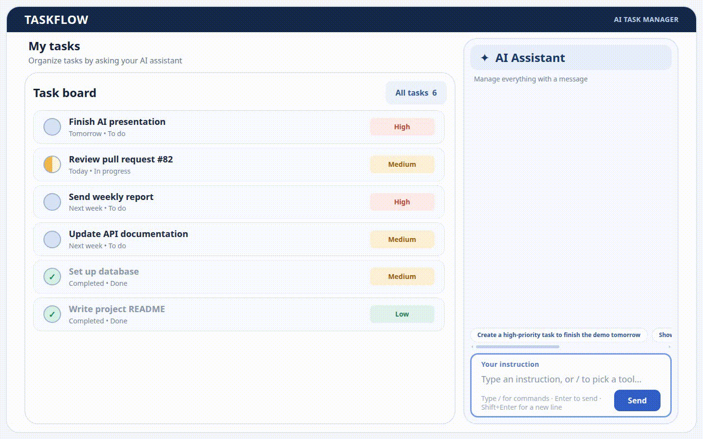
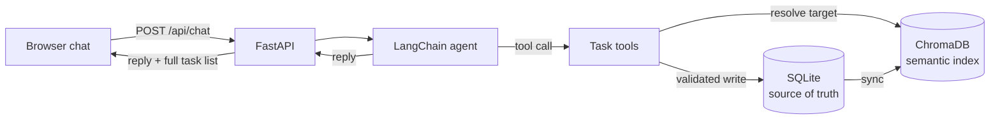

# TaskFlow: AI Agent Task Manager

A single-page task manager you control by chatting. Type an instruction such as
*"Create a high-priority task to finish the demo tomorrow"* and an LLM agent turns it into validated
task operations. Tasks persist in SQLite, and ChromaDB provides semantic search so you can find
tasks in natural language.

## Demo



- **Stack:** FastAPI, SQLModel + SQLite, ChromaDB, LangChain agent (`create_agent`), Tailwind 4 frontend (plain HTML + JS, no framework)

## Requirements coverage

| Assignment requirement | Where it is met |
| --- | --- |
| Chat and task list visible on one page | `static/index.html`: task board on the left, AI assistant on the right (stacked on small screens) |
| Create, list, edit, move, change status, complete, delete from chat | Agent tools in `app/tools.py`: `create_task`, `list_tasks`, `search_tasks`, `update_task` (also move, complete and edit), `delete_task` |
| Title, description, status, priority, due date | `app/models.py` (`Task`) |
| Semantic search with ChromaDB | `app/search.py`, used by `search_tasks` and by target resolution |
| Persistence across refresh and restart | SQLite (`data/tasks.db`) plus a persistent Chroma index (`data/chroma`), rebuilt from SQLite on startup. The conversation is stored too, so the chat is still there after a refresh |
| Structured actions, validation, clear success/error replies | Typed tool arguments, Pydantic validation, and tools that return plain-text results and errors (never raise) |
| Ask before changing or deleting an ambiguous task | Enforced in code (`_resolve` in `app/tools.py`), not only in the prompt. See [Safety rules](#safety-rules-enforced-in-code) |
| Deterministic IDs, reliable source of truth | Integer autoincrement IDs that are never reused. SQLite is the source of truth and Chroma is only an index |
| Chat is the primary control | Everything works from the chat box. Typing `/` opens a command picker (`/clear` for now), and rows the chat changes flash on the board |

## Quick start

**Prerequisites:** [`uv`](https://docs.astral.sh/uv/) (it installs Python 3.14 for you) and at least one free LLM API key. Node.js is only needed if you edit the UI.

```bash
git clone <repo-url> taskflow && cd taskflow

uv sync                          # Python dependencies
cp .env.example .env             # then add at least one API key (see Configuration)

uv run python -m app.seed --demo # optional: the six-task demo board (only inserted if the table is empty)
uv run fastapi dev               # http://127.0.0.1:8000
```

`uv run python -m app.seed` without `--demo` inserts 24 varied tasks instead. That is the set the
retrieval evaluation uses, and it is handy for trying search on a bigger board.

> **First run needs internet.** Chroma downloads its default local embedding model
> (all-MiniLM-L6-v2, about 80 MB) the first time it indexes or searches. After that, search runs
> offline. Only the chat itself needs an LLM provider.

The compiled stylesheet `static/styles.css` is committed, so the app runs without Node. If you
change classes in `static/index.html`, rebuild it with `npm ci && npm run build` (or `npm run dev`
in a second terminal to rebuild while you edit).

### Configuration (`.env`)

| Variable | Purpose |
| --- | --- |
| `GROQ_API_KEY`, `GOOGLE_API_KEY`, `OPENROUTER_API_KEY` | Set at least one. Each may hold several comma-separated keys. Providers without a key are skipped. Extra keys only add quota when they belong to separate limits: Gemini limits are per Google Cloud project and OpenRouter's per account, so use keys from different projects or accounts |
| `LLM_CHAIN` | Ordered `provider:model` fallback list (see [LLM choice](#llm-choice)) |
| `DATABASE_URL` | SQLite location (default `data/tasks.db`) |
| `CHROMA_PATH` | Chroma index location (default `data/chroma`). Safe to delete, since it is rebuilt from SQLite |
| `CHECKPOINT_PATH` | Where the agent's per-session memory is stored (default `data/checkpoints.db`) |
| `APP_ENV` | `dev` turns on SQL logging |

### Other ways to use it

```bash
uv run python -m scripts.chat_cli   # chat with the agent in the terminal
uv run pytest                       # test suite, no API keys needed
```

## Using the chat

Type an instruction in plain language. The agent decides which task tool to use.

Typing `/` opens a command picker. For now it has one command, `/clear`, which empties the chat
(your tasks stay). Arrow keys and Enter (or Tab) choose from the picker, and Esc closes it. In the
text box, Enter sends and Shift+Enter adds a line. The box grows to three lines and then scrolls.

## How it works



### How actions are executed

1. The browser sends `{message, session_id}` to `POST /api/chat`. The message is validated (1 to 1000 characters).
2. The agent (`app/agent.py`) gets a system prompt that includes today's date and weekday, so words like "tomorrow" and "Friday" become ISO dates. It can act **only through tools**.
3. The model emits a structured tool call, for example `update_task(target="demo task", status="in_progress")`.
4. The tool validates every argument (enums, ISO dates, title rules), resolves the target task with semantic search, writes to SQLite, then updates the Chroma index.
5. The tool returns a plain-text result or error, and the model turns it into a short reply. The API returns the reply **and the full task list**, so the board always matches the database. The browser flashes the rows that are new or changed and scrolls the first one into view, so a change is easy to spot even on a long board.

### Safety rules (enforced in code)

These live in `app/tools.py`, so they hold even if the model misbehaves:

- **Ambiguity:** update and delete take a natural-language `target`. No match above similarity 0.30 means "not found". Several matches within 0.05 of the best means the tool changes nothing, lists the candidates, and the agent asks the user which one.
- **No guessed IDs:** a `task_id` is accepted only if it appeared in a candidate list shown to the same session earlier.
- **Delete needs confirmation:** the first `delete_task` call only records a pending delete. It runs only if called again in the user's *next* message **and that message is a clear yes**. The check is code (`is_confirmation`), not the model: "no", "cancel", "are you sure?", "yes but don't" and long messages never count. Stale or different-task confirmations are refused too.
- **The model cannot choose the session:** `session_id` comes from the run context, not a model-filled argument.
- **Tools never raise:** every failure becomes an `Error: ...` or `Not found: ...` string the model must relay.

### Semantic search

Each task is stored in Chroma as `title + description` with cosine similarity. SQLite stays authoritative: search returns IDs, and the rows are loaded from SQLite. Every write commits to SQLite first and then syncs the index. If the sync fails, the task operation still succeeds and the index is marked stale, and the next search rebuilds it from SQLite. `reindex_all` (also run on startup) adds missing tasks, fixes edited ones and removes stale ones, so a deleted or damaged index heals itself. A task's status is stored as index metadata, so "unfinished tasks about X" filters done tasks inside the vector query instead of after the result limit.

## LLM choice

TaskFlow can use any provider that supports tool calling through LangChain. I chose **free-tier models with an automatic fallback chain**, so the app runs without paid keys and survives rate limits during a demo.

Default order (`LLM_CHAIN`), fastest and most reliable first, as measured with `scripts/check_models.py`:

1. `groq:openai/gpt-oss-120b`
2. `google_genai:gemini-3.5-flash-lite`, `gemini-3.6-flash`, `gemini-3.1-flash-lite`
3. `openrouter:openrouter/free` (OpenRouter picks a free model that supports tool calling)

`app/llm.py` adds a `ProviderFallbackMiddleware` that moves to the next model **only for provider failures** (429/quota, 402, 408, timeouts, connection errors, 5xx). Validation errors, tool errors and bugs are raised instead of silently spending quota on the next model. Each model has a 20-second timeout and no SDK-level retries, so a stalled model fails over quickly.

## Example prompts

These are the assignment's own example instructions, run on the six-task demo board.

| # | Prompt | What happens |
| --- | --- | --- |
| 1 | *Create a high-priority task to finish the demo tomorrow* | `create_task` with `priority=high` and `due_date` resolved from today's date |
| 2 | *Show all unfinished tasks related to documentation* | `search_tasks(include_done=false)`. Finds "Update API documentation" and leaves out the finished README task |
| 3 | *Move the demo task to In progress and mark the weekly report Done* | Two `update_task` calls from one message. Both rows flash on the board |
| 4 | *Change the priority of the API task to Low* | "The API task" can mean the documentation task or the pull request about API endpoints. If the scores are close, nothing changes and the agent asks which one. Replying *the documentation one* finishes it with the candidate's `task_id` |
| 5 | `Delete the README task`, then *yes* | The first call only asks for confirmation. Deletion happens after the confirming message |

Prompts 1 to 5 are the scenes in the scripted demo (`demo/test_demo.py`). Whether the agent asks in
prompts 3 and 4 depends on how close the matching tasks score. The confirmation in prompt 5 never
varies.

## Prompts used to build TaskFlow

I built this one step at a time, with a fresh AI session per step, and every prompt starts with
"read the repo first" so a session picks up what the earlier ones left behind. Here are five of
them, lightly cleaned up. Each is followed by what went wrong and how it was corrected.

### 1. Database layer

```
Project intro:
I'm building "TaskFlow", an AI task manager with FastAPI where every task operation goes through an AI agent.

Tasks:
Read the repo first. Build ONLY the database layer in this session: no API routes, no frontend, no AI, no vector DB. Use SQLModel.

- app/models.py: Task with id (autoincrement, never reused after a delete), title (max 200, stripped, not empty), description, status (todo | in_progress | done), priority (low | medium | high), due_date (optional), created_at and updated_at. Store the enum values, not the names.
- app/schemas.py: TaskCreate, TaskRead and TaskUpdate, kept apart from the table model. TaskUpdate has every field optional, but title, status and priority can't be set to null.
- app/database.py: DATABASE_URL and APP_ENV come from the environment, and SQL echo is on only in dev. Add a .env.example.
- Tests run on a separate file-based SQLite database from TEST_DATABASE_URL. The fixture must refuse to run if it equals DATABASE_URL.

Keep it simple: no extra abstractions or features. At the end run ruff, pyrefly and pytest, fix everything and show me the output. Don't commit.
```

*What went wrong:* my first version of this prompt used an in-memory test database and had no
environment config, so I followed up to move both out. Later, nine tests failed at once. The cause
was two pytest runs sharing `data/test.db` at the same time, not the code. One run alone passed.

### 2. Task functions and semantic search

```
Project intro:
I'm building "TaskFlow", an AI task manager with FastAPI. SQLite is the source of truth and ChromaDB is only a search index.

Tasks:
Read the repo first. The database layer exists. Build ONLY the task functions and semantic search: no API routes, no frontend, no LLM.

- app/search.py: a persistent Chroma collection with cosine distance, indexing title + description, with the Chroma ID equal to the task ID. Functions: index_task, remove_task, search(query, limit) returning (task_id, similarity) best first, and reindex_all(session) so Chroma always matches SQLite.
- app/services.py: plain functions that take a Session. Every write commits to SQLite first and then syncs the index. Add find_tasks(session, query, include_done, limit), which searches, loads from SQLite and skips IDs that no longer exist.
- app/seed.py: about 25 realistic tasks with mixed statuses, priorities and due dates, including a couple of near-duplicates so ambiguity can be tested later.
- Tests with an ephemeral Chroma client that is isolated per test. "documentation" should find the docs task, and "unfinished docs" should skip done ones.

Keep it simple. At the end run ruff, pyrefly, pytest and the seed script, fix everything and show me the output. Don't commit.
```

*What went wrong:* the AI's sandbox couldn't download Chroma's embedding model, so its tests ran on a
stand-in embedder and passed. With the real model on my machine, `documentation` and
`unfinished docs` did not find the API docs task. I pasted the output back and told it to run the
test itself. It found a copy of the model, reproduced the failures and measured the rankings. The
code was fine. The seed descriptions were too far from the word "documentation", so they were
reworded.

### 3. LLM fallback chain

```
Project intro:
I'm building "TaskFlow", an AI task manager with FastAPI. I use free-tier LLM keys, which get rate limited, so the agent has to fall back across providers and models.

Tasks:
Read the repo first. Build ONLY the LLM layer in app/llm.py: no tools, no task logic, no API. Use LangChain with init_chat_model and read the installed docs if unsure.

- LLM_CHAIN is an ordered, comma-separated list of "provider:model" entries. Split on the first colon only. Keys come from environment variables through an explicit mapping, and entries without a key are skipped with a warning.
- Use a short timeout and no SDK retries, so a rate-limited model fails over quickly.
- Fall back ONLY on provider failures: 429 or quota, timeouts, connection errors and 5xx. Never on validation errors, tool errors or my own bugs, because that would hide real problems and burn quota. I think the built-in fallback middleware catches every exception. Check the installed version, and if it can't filter by error type, write a small custom one.
- Log which model answered each call, and warn on every fallback.
- scripts/check_models.py sends a real tool-calling request to each entry on its own. It's for me to run by hand, not part of pytest.

Tests use fake chat models and make no real API calls. Keep it simple. At the end run ruff, pyrefly and pytest, fix everything and show me the output. Don't commit.
```

*What went wrong:* LangChain's built-in model fallback does catch every exception, which is exactly
what I suspected. A bug in a tool or prompt would have quietly burned quota on every model, so the
chain uses a custom middleware instead. Real use also showed that one Gemini model was too slow, so
it left the default order.

### 4. Agent with the safety rules in code

```
Project intro:
I'm building "TaskFlow", an AI task manager with FastAPI. Services, search and the LLM chain already exist.

Tasks:
Read the repo first. Build ONLY the agent: tools, run_agent and a terminal chat script. No API routes, no frontend. Use create_agent, not AgentExecutor or a custom graph.

- app/tools.py wraps the services as LangChain tools. The model must never be able to act on an ID it invented.
- update_task and delete_task take a natural-language `target`, resolved with find_tasks, with the thresholds as named constants. No match means "not found". Several plausible matches means do NOT act: list the candidates with their IDs and ask. One clear match means act. A `task_id` is accepted only if it was in a candidate list shown to this same session.
- delete_task needs confirmation enforced in code: the first call only records a pending delete, and it runs only when called again in a LATER user turn.
- session_id comes from the run context. It is never an argument the model fills in. Tools return clear success or error strings and never raise.
- app/agent.py: run_agent(message, session_id), with today's date and weekday in the system prompt and per-session history.

Test the tools with no real LLM: exact, none and ambiguous matches, a candidate ID accepted and an invented one rejected, and a delete refused in the same turn but executed in a later one. Keep it simple. At the end run ruff, pyrefly and pytest, fix everything and show me the output. Don't commit.
```

*What went wrong:* the first version only checked that a delete was confirmed in a later turn, not
what the user actually said in that turn. A review pass caught it (`8824b0c`). The server now also
checks that the reply is a clear yes (`is_confirmation`), with tests for "no", "are you sure?",
confirming a different task and deleting twice in one turn.

### 5. Review against the assignment

I attached the assignment PDF and the repo as a git bundle.

```
Check the repo against the assignment PDF and tell me what's still open. Flag anything that doesn't meet a requirement.

Also review the implementation and suggest improvements. I think these should be added:
- persistent chat history
- a /clear command to empty the chat
- the agent can do CRUD now, but not filtering or sorting yet (due date, priority)

Also, I used a plain POST endpoint for the chat. A friend went with WebSockets. Is mine a good choice? Explain the pros and cons.

Then list everything so I can decide what to do. Add effort estimates.
```

*What it led to:* chat history that survives a refresh and a restart (`c7b219e`), `/clear`
(`a1ea0b4`), due-date and priority filtering and sorting in `list_tasks` (`05f464e`), the
confirmation fix above, and the first README. The chat stayed a plain POST endpoint: each reply
comes back together with the full task list in one response.

## Failures encountered and how they were corrected

1. **Free-tier models were slow or rate-limited.** A single provider stalled or returned 429 during chats, and one Gemini model was too slow to be usable.
   *Fix:* an ordered fallback chain across providers (`775b9c0`), multiple comma-separated keys per provider (`634d96e`), a 20-second timeout with no SDK retries, and a reordered default chain with the slow model removed (`96b44ee`).
2. **Blanket fallback hid real bugs.** LangChain's built-in model fallback catches every exception, so a bug in a tool or prompt would silently burn quota on every model.
   *Fix:* a custom middleware that falls back only on provider failures. It also handles quirks such as Groq's 413 on the per-minute token budget and OpenRouter's millisecond timeouts.
3. **A prompt alone cannot guarantee confirmation before a delete.** The model could delete in the same turn, reuse an old "yes", or call delete again after the user said "no".
   *Fix:* a two-step delete tracked in code (pending delete plus turn number), where the server also checks that the user's reply is a clear yes. Tests cover deleting twice in one turn, a stale confirmation, confirming a different task, and replies like "no" or "are you sure?".
4. **The model could guess or invent targets and IDs.**
   *Fix:* tools take a natural-language `target`, and `task_id` is accepted only from a candidate list shown earlier in the same session. Tests cover invented IDs and IDs from another session.
5. **Clarification thresholds were guesswork.** Too low means wrong tasks get changed, too high means constant questions.
   *Fix:* `scripts/eval_retrieval.py` runs labelled queries (act / ask / list / none) through the same decision rule as the agent and prints a threshold sweep, so `MIN_SIMILARITY` and `AMBIGUITY_MARGIN` are chosen from data.
6. **A failed index sync looked like a failed task.** When Chroma errored after SQLite had committed, the agent said the operation failed and a retry created a duplicate. Done tasks could also use up the search limit before the "unfinished" filter ran.
   *Fix:* index sync failures are logged and healed on the next search, and the status filter moved into the query (`tests/test_index_sync.py`).
7. **Tailwind from the CDN script is development-only.**
   *Fix:* the UI serves a compiled stylesheet from `/static` (`a9fa30e`). It is built with `npm run build` and committed (`320cfcd`), so the app runs without Node.
8. **Tests passed on a stand-in embedder and failed on the real model.** The first seed descriptions were too far from the word "documentation" for the real model, and a test on fake embeddings couldn't show it.
   *Fix:* reworded the seed descriptions and re-ran against the real model. The tests that depend on it use the real embedder, and the API tests use a deterministic offline one (`WordHashEmbedding`).
9. **Two test runs at once failed nine tests.** Both used `data/test.db`.
   *Fix:* find the cause by reproducing it, then run one suite at a time. The test fixture also refuses to run if `TEST_DATABASE_URL` equals `DATABASE_URL`.
10. **Task changes were hard to see.** With 24 demo tasks the board scrolled, so a task that the chat had just created or edited was often off-screen, and the demo video didn't show the update.
    *Fix:* a six-task demo board (`python -m app.seed --demo`, `96f8ca0`), changed rows flash and scroll into view, and the compact layout now applies up to 1000px of window height, so the whole demo board stays visible at 1440x900 (`03053f4`).
11. **A one-line chat input was awkward for longer instructions.**
    *Fix:* a text area that grows to three lines and then scrolls, with Enter to send and Shift+Enter for a new line (`03053f4`). A `/` picker lists the available commands (`/clear` for now).

## Testing and evaluation

```bash
uv run pytest                          # unit and API tests (scripted fake models, no LLM calls)
uv run python -m scripts.eval_retrieval            # retrieval quality; add --verbose for passing cases
uv run python -m scripts.check_models              # real tool-calling check of each model in LLM_CHAIN (uses quota)
```

- The suite has about 200 tests. It covers models, services, search, index sync and healing, tools (including every safety rule above), `/clear` and the command list, the LLM fallback layer, the agent loop with a scripted model, and the API.
- Tests that rely on Chroma's real embedding model need internet on the first run (see the note under Quick start).
- The retrieval eval indexes the 24 seed tasks in a throwaway in-memory Chroma and reports pass rates per case type, top-1 / top-3 hit rate and MRR.

## Demo recording

```bash
uv run playwright install chromium
uv run pytest demo --headed
```

This starts a throwaway server with its own database, seeded with the six-task demo board. It
drives the real UI at 1440x900 through the five prompts above, plus a refresh to prove persistence,
and writes `demo/output/taskflow-demo.webm`. It uses your real LLM keys, so replies vary between
runs and each check is reported at the end. It needs internet on the first run for the embedding
model.

The exact prompts, in order, are listed in [`docs/demo.md`](docs/demo.md) if you would rather record by hand.

## Known limitations

- Tasks are shared by everyone using the instance (there is no user login).
- Run a single server process. The agent's per-session state and the SQLite files are not meant to be shared across several workers.
- The free LLM tiers are rate limited, so a reply can occasionally take longer while the chain falls back to the next model.
- Slash commands are shortcuts. Plain language works everywhere, and an unknown `/word` is sent to the agent as normal text.

## Project layout

```text
app/        models, schemas, services, search (Chroma), tools, commands, agent, llm, FastAPI app, seed
static/     index.html (UI), input.css (Tailwind source) and the compiled styles.css
tests/      pytest suite
scripts/    chat_cli, eval_retrieval, check_models
demo/       Playwright demo recorder
docs/       demo script
```
